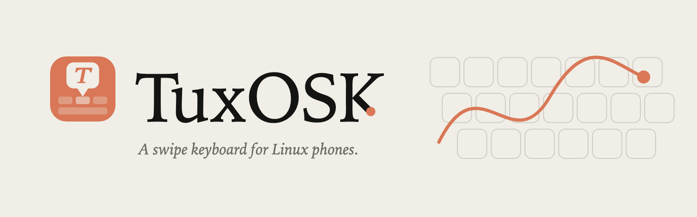
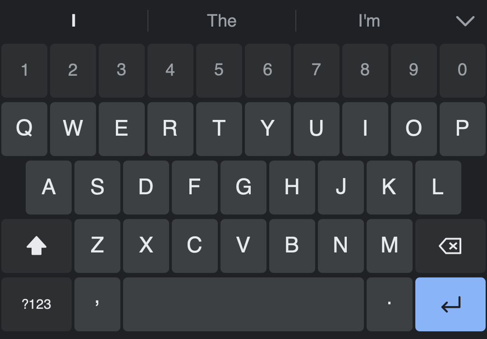
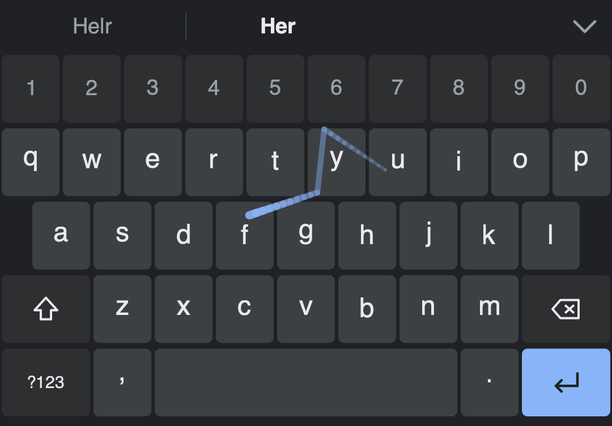
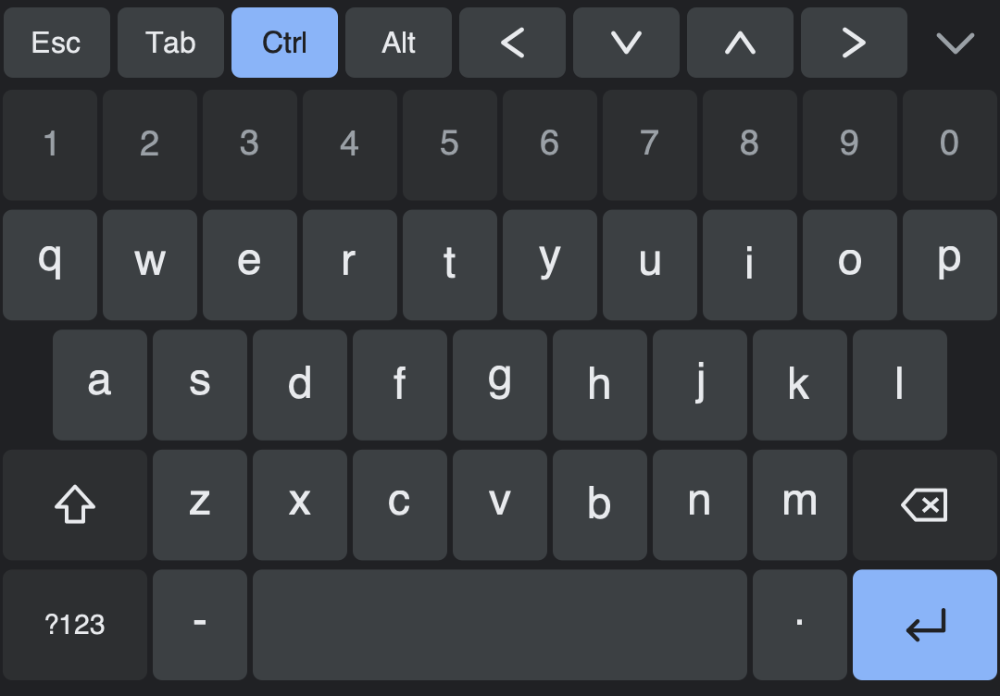

# TuxOSK

A fast on-screen keyboard for Wayland phones (phosh / phoc, postmarketOS). Gboard-style: swipe typing, number row, suggestions, autocorrect. Replaces the stock phosh keyboard.

  

## Features
- Swipe typing (SHARK2-style decoder), word suggestions, autocorrect
- Dedicated number row; likelihood-weighted tap targets (invisible bigger hitboxes for likely next letters)
- Terminal layout (Esc, Tab, Ctrl, Alt, arrows) chosen automatically for terminal fields
- Hold space: language picker, then keyboard settings (full-screen dialog)
- Word filters: slurs filtered by default (profanity is kept); add your own lists or block words from the keyboard
- Animations, with a Reduce motion setting; light theme; taller keys
- Hold the phosh home bar to show/hide

## Build
Needs cairo, glib/gio, wayland-client, xkbcommon, wayland-scanner, cmake, ninja.

    cmake -S . -B build -G Ninja && cmake --build build && ctest --test-dir build
    sudo cmake --install build        # or: --prefix ~/.local

## Use with phosh
    osk-select tux        # phosh starts TuxOSK
    osk-select stevia     # back to the stock keyboard
    osk-select status

## Settings
Hold space, tap "Keyboard settings". Stored in `~/.config/tuxosk/config`. Custom filters: one word per line in `~/.config/tuxosk/filters/<name>.txt`. Extra languages: `<code>.txt` (word count lines) in `~/.local/share/tuxosk/`.

## Licence
MIT. See NOTICE for the word list attribution.
